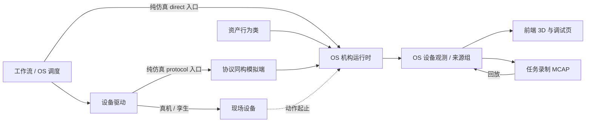

# Uni-Lab-OS 工站数字孪生开发指南

适用读者：用 Uni-Lab-OS 为实验室工站开发数字孪生的领域开发者、设备包开发者和资产开发者。

## 1. 概览

一个工站接入完成后，同一套驱动、同一张设备图、同一份工作流可以在三种模式之间**整站切换**：

| 模式 | 动作发往哪里 | 3D 画面从哪来 | 库存与任务 | 观测值的性质（basis） |
| --- | --- | --- | --- | --- |
| 纯仿真 `sim` | 不构造驱动，或驱动连协议同构的模拟端 | OS 按资产行为类产生运动 | OS 照常调度和结算 | `simulated` |
| 数字孪生 `twin` | 真机 | 驱动动作开始和结束时，OS 按同一个资产行为类推演 | 照常结算，以真机应答为准 | `estimated` |
| 真机 `real` | 真机 | 无（将来接真机读回时为 `observed`） | 照常结算 | — |

此外还有辅助的**回放**：把录下的运动和数据库状态按时间重放，不执行动作、不动库存。

整站切换的约定：

- 所有设备一起切，不按设备分组混合；
- 有运行中、暂停或排队的任务时拒绝切换；
- 前端只显示画面来源，不负责切换真机，切换由运维在工站机上执行。

驱动的传输方式不限：厂家 TCP 协议、PLC、串口、HTTP、厂商 SDK 都按同一套分层接入，协议差异只存在于驱动和它的模拟端内部。



## 2. 归属：什么写在哪里

接入的核心是**一份资产行为类同时服务纯仿真、孪生和真机**：机构怎么动写在资产里，驱动只管和设备通信，OS 负责把两者对上并运行。

| 内容 | 归属 | 说明 |
| --- | --- | --- |
| 关节、限位、库位、台面基准、工具点 | 资产 USD | 跟设备型号走 |
| 机构动作（开门、转到某角度、取放板、通道到某点）和设备固有时长 | 资产行为类，随资产修订发布 | 同一型号在哪个工站都一样；工艺或配方决定的时长不进资产 |
| device / action 合同、真机驱动、协议 | 设备包驱动，纯 `@device` / `@action` | 驱动里不出现资产 UUID，不放仿真代码 |
| 资产指向驱动 | 统一目录条目的 `module` / `source_registry` | 方向是条目 → 驱动 |
| 台面上摆了什么、示教偏移、协议级动作展开成哪些基本动作（步骤表） | 工站数据 | 每个工站不同，不进资产 |
| 任务、调度、摆位、限位校验、读回、观测、库存结算、碰撞查询 | OS | 资产不碰 USD，也不写库存；设备包不得成为库存的第二写者 |
| 机械臂逆解与路径搜索 | 机器人领域库 | 从 OS 取场景和碰撞查询，OS 校验它交回的轨迹回执 |

挂载关系和液体量的变化写在动作合同里，由 OS 结算；资产只给物料的画面提示 `carry`，不改库存。

以下做法已废弃，新开发不要再用：

- 在设备包里写资产动作文件；
- 在资产锁里手写 OS 绑定；
- 在设备包内自己做摆位（摆位一律由 OS 做）；
- 在设备包里另写一份行为表供模拟端使用（行为统一写在资产行为类里）；
- 读驱动命令日志来推演画面的孪生跟随器（孪生改由 OS 在驱动动作开始和结束时按资产行为类推演）。

## 3. 资产行为类

行为类的写法、步骤键、视图、试跑和发布细则，以资产管线技能 `lab-station-asset-pipeline` 的参考页 `references/asset-behavior-mechanism.md` 为准。这里只写要点。

### 3.1 写法

行为类是**零导入的普通 Python 类**：不 import OS、USD 库、设备包或工站代码，无参构造。公开方法就是机构动作，第一个参数是 OS 传入的只读关节视图，另可按名字要 `sites`（库位）和 `materials`（物料几何）两个视图。

```python
class Freezer:
    def open_door(self, joints):
        """开门：抽屉伸到资产声明的最大行程"""
        return {"move": {"drawer_joint": joints.upper("drawer_joint")},
                "duration": 4.0, "state": {"door": "open"}}
```

返回一个步骤或步骤列表。步骤键：

| 键 | 含义 |
| --- | --- |
| `move` | `{关节: 目标}`，SI 单位（米、弧度） |
| `duration` | 秒 |
| `state` | 动作完成时写入的语义状态，例如 `{"door": "open"}` |
| `carry` | `{"from": 库位, "to": 库位}`，物料画面上的走向，只是显示提示 |
| `ease` | 是否起停平滑，默认是 |
| `spin` | 连续转动关节（转子、转盘）按角速度积分 |
| `advance` | 转动关节相对转过一个增量，整圈范围内按整圈折回（卷轴、收卷盘） |

规则：

- 位置一律从资产自己的关节和库位算，不查硬编码的表；确实没有依据的常数写明是候选并说明来源。
- 目标超出资产声明范围、平移关节没有有限行程、物料缺少需要的几何属性时，OS 直接拒绝。不要在行为类里裁剪或填默认值来凑通过。
- 行为类可以保留少量自身状态，但不保存库存事实。
- 非直角机构（SCARA、六轴）不写行为类，走轨迹库或机器人包。

### 3.2 驱动动作怎么对上机构动作

- OS 按**方法名和参数名**对应：同名、参数同名即对应，驱动多出来的可选参数（如超时）忽略。新写行为类时，照同类驱动已有的方法名起名。
- 名字或参数对不上的老驱动，在 `@action` 上加一行 `motion=` 声明，例如 `motion={"action": "rotate", "args": {"angle_deg": "angleEnum"}}`；参数可以是数值表达式或文字模板。不改资产。
- 没有驱动的被动机构（门、抽屉等），由 OS 从行为类生成一个只声明合同的设备。

### 3.3 资产要补的信息

行为要用到而资产里没有的，做成候选修订补上，逐项写依据：有限行程、库位（存取位、交接位、承托面）、台面基准与工具点。

**估出来的行程、工具点和时长必须写明依据，并标为非标定。**估计值只说明行为与资产几何自洽，不是厂家参数或实测。

### 3.4 试跑与发布

单个资产试跑，不需要驱动、设备图或工站：

```bash
python -m unilabos.simulation try --package <候选包> --action open_door --action 'rotate={"angle_deg": 90}' --output try-report.json
```

至少覆盖：每个动作走一遍；一个越界或缺前置条件的调用被拒绝；到位值与手算一致。

行为改动发布成资产修订（需要明确授权，流程见技能参考页“发布成资产修订”）。**发布不会改变任何现有锁**：要把工站的场景资产锁改到新修订并重新拉取，改动才生效。设备包只需要个别 `motion=` 声明。

## 4. 三种运行方式

### 4.1 每台设备的运行方式

三种运行方式用同一个行为类：

| 方式 | 驱动 | 机构动作怎么产生 | basis |
| --- | --- | --- | --- |
| 纯仿真 | 不构造驱动（`direct`），或驱动连协议模拟端（`protocol`） | OS 按行为类执行，按行为类的时长完成 | `simulated` |
| 孪生 | 驱动照常执行 | OS 在驱动动作开始和结束时按行为类推演，不读命令日志 | `estimated` |
| 真机 | 驱动照常执行 | 不受影响 | — |

每台设备用哪种方式，写在工站仿真装配里（schema `unilab.station-simulation/1`，由环境变量 `UNILABOS_SIMULATION_COMPOSITION` 指向）。装配只有一种写法：每台设备一段 OS 仿真执行配置的 `composition`（见 4.2），`attachment: direct` 不构造驱动，`attachment: protocol` 驱动照常执行、画面按行为类推演。旧的 `unilab.mechanism-runtime/1` 和设备条目上的 `attachment: follow` 已不再接受。

### 4.2 仿真装配：入口 × 反馈 × 完成

只在 `sim` 下，每台设备还要说明“怎么仿”。装配写在 OS 仿真执行配置的 `composition` 片段里，由 OS 的 `compile_composition()` 编译和校验：

```json
{
  "physics_backend": "blender_kinematic",
  "attachment": "direct",
  "composition": {
    "attachment": "direct",
    "feedback": "kinematic",
    "completion": "feedback",
    "scheduler": "coupled"
  }
}
```

| 字段 | 取值 | 含义 |
| --- | --- | --- |
| `attachment` 入口 | `protocol` | 原驱动连同协议的模拟端，驱动代码不改 |
| | `direct` | 不经协议，OS 直接调行为模型 |
| `feedback` 反馈 | `analytic` | 行为类算终态与时长；运动只是显示轨迹 |
| | `kinematic` | 运动学场景求值后读回关节和父子关系，作为到位证据；在读回的位姿上可用 OS 碰撞查询检查几何干涉。不做刚体动力学和接触力求解 |
| | `physics` | 物理引擎实测接触、到位、稳定 |
| | `resource_state` | 设备应答由 OS 规范库存事实推出 |
| `sources` | `{端口: {source, ref}}` | 逐端口覆盖来源，形成混合来源；每个端口只有一个来源 |
| `completion` 完成 | `feedback` | 反馈判定完成即应答，OS 随后结算 |
| | `committed_effect` 或设备包登记的先提交策略 | 先取得规范库存提交回执再应答；策略可声明 `required_ports` |
| `scheduler` | `coupled` | 新装配一律用 `coupled` |
| 外层 `physics_backend` | `blender_kinematic` / `blender_bullet` / `isaac` | 选运动学或物理世界 |
| 外层 `attachment` | 同 `composition.attachment` | 两者必须一致 |

规则：

1. `resource_state` 必须配 `committed_effect`，否则应答会早于它依据的库存事实。
2. 未知字段、取值或不兼容组合在启动端点或场景之前报错；不得因为连不上某个来源就降级成另一种反馈。
3. 没声明的来源不启动：没有 `kinematic` / `physics` 就不起引擎，`direct` 设备不起协议端点。
4. 证据不能跨级提升：`analytic` 的运动不能当作 `kinematic` 或 `physics` 的证据；`kinematic` 通过不等于有 `physics` 资格。
5. 校验分工：OS 校验字段名、`attachment`、`scheduler`、来源选择和完成策略的必需端口；`feedback` 取值和规则 1 由设备包在自己的装配声明里校验。

资产行为类由 OS 机构运行时执行，它是上表里 `feedback: kinematic` 一档的实现：资产 USD 在进程内的运动学场景里求值，每段运动终了是一个确认步，摆位、读回关节，读回与计划值在 1e-6 m / 1e-6 rad 内才算到位；只是计时到了、动画播完不算完成，读回不到位报 `readback_mismatch`、动作失败。搬运在所在段的确认步核对两端库位并记下读回后的实际位置。不做刚体动力学和接触力。完成证据标 `kinematic`，带各确认步的读回和装配摘要。它只接受 `kinematic` + `completion: feedback` + `scheduler: coupled`、不带 `sources` 的装配，其余组合（包括 `analytic`，它不读回、不能作为机构动作的证据）在启动前报错，不降级；孪生（`twin-feed`）下拒绝 `direct`。工站仿真装配文件按设备写，由设备包的工具按场景图、资产锁和驱动的 `@action` 生成，不手写：

```json
{
  "schema": "unilab.station-simulation/1",
  "assets": {"lock": "assets.usd.lock.json"},
  "devices": {
    "peptide_island_cold_storage": {
      "asset": "bioyond_tcp_freezer",
      "composition": {"attachment": "direct", "feedback": "kinematic", "completion": "feedback", "scheduler": "coupled"},
      "actions": {"BY_OpenDoor": {"mechanism": "open_door"}}
    }
  }
}
```

要分清三个事件：**设备应答**（模拟端或真机报告做完）、**库存回执**（OS 规范库存提交成功）、**Action 成功**（OS 原生请求最终成功）。任何模式下，Action 成功都要求库存已结算。

### 4.3 各取值的开发要求

**`protocol`**

- 连接参数（地址、端口、串口号、站号等）一律来自设备图节点的 `config`，不写死。
- 驱动为每条命令写命令日志：命令唯一 id、可映射到图节点的设备标识、动作名和参数、带时区的发出与应答时刻、终态（成功 / 失败 / 未知）。
- 模拟端讲与真机相同的协议：报文、字段、握手顺序、错误语义一致，驱动无需感知自己连的是模拟端。有 Start / Busy / Done / Reset 一类握手的要模拟完整握手；不虚构设备本来没有的控制器。
- 协议自带的“模拟执行”开关只在 `sim` 下打开。
- 写到协议上的动作号、参数和启动信号必须与 OS 授权的意图一致才允许运动；驱动提前失败、缺启动信号、参数不一致、完成信号陈旧都不得报成功。

**`direct`**：不起协议端点，参数与 `@action` 一致；仍写同字段的命令记录；有原驱动的设备只用它对照和调试，不能替代 `protocol` 的握手验收。

**`analytic`**：状态变化只在动作成功完成时提交，不能在开始时就改（孪生遇到真机失败时不提交）；关节名、单位、轴向、上下限与资产一致；没有行为的动作给默认计划（短时长、无运动），不报错。

**`kinematic`**：按确认步更新轨迹并读回，只收到命令、计时结束或动画播完都不算完成；抓取前核对请求、对象身份、来源关系和对接位姿再挂载，释放时保留实际世界变换，不得把物体直接写到目标位置；吸头与液路在实际对接后才计量；证据标 `kinematic`，不得生成虚假的接触力。

**`physics`**：设备包提供物理世界适配和接触、稳定判据；每个物理后端分别验收，换后端不沿用资格；只比工程公差，不要求两个求解器逐帧一致。

**`resource_state`**：只读 OS 规范库存并映射成设备事实，不维护库存副本；必须配 `committed_effect`。

**`sources` 混合**：每个端口一个来源，至少两个端口真的读自不同来源；任一来源坏了、过期或缺失就拒绝启动或判失败。

**`committed_effect`**：先证明效果、再提交规范库存、取得关联本请求的回执，然后才应答；提交失败不应答；回执的 Job 不对时拒绝；重放同一请求不重复扣料；缺 `required_ports` 不能完成。

### 4.4 孪生的规则

- **只旁观**：孪生不发命令，不碰真机，驱动照常执行。
- **只在成功时提交**：只有真机成功应答才提交状态变化；失败或结果未知时不改状态。
- **如实标注值的性质**：孪生样本 `basis = estimated`（按命令推演，没有读真机传感器），纯仿真 `simulated`，只有真机读回才是 `observed`。OS 按 provider 自动推出，可用 `UNILABOS_OBSERVATION_FEED_BASIS` 覆盖。属性描述里的 `semantic: "observed"` 表示“实际状态而非目标值”，与 basis 无关。
- **源时间与接收时间分开**：快照里 `sampled_at` 是来源给出的时间，`received_at` 是 OS 收到的时间，两者都保留。
- **节奏**：按标称时长播放；真机比标称慢就停在终点等应答，比标称快就以应答为准接着演下一条。

第一版孪生不读实时传感器，与真机真实位置可能有偏差。协议能读到实时状态时（寄存器、轮询、状态接口），后续可以加只读遥测桥做状态校正。

### 4.5 按传输方式接入

| 传输 | 真机时驱动连 | 纯仿真时连 | 切换改哪些配置 |
| --- | --- | --- | --- |
| 厂家 TCP 协议 | 厂家服务地址和端口 | 本机同协议模拟服务 | 地址、端口、模拟执行开关 |
| PLC（如 Modbus TCP） | PLC 地址和端口 | 独立运行的 PLC 仿真服务，寄存器映射与真机相同 | PLC 地址、端口 |
| 串口 | 串口设备 | 虚拟串口对的一端，另一端接模拟器 | 串口设备名 |

三种传输的共同点：驱动代码不知道自己连的是不是模拟器，切换只改设备图里的端点配置。

## 5. 每一层能验证什么

仿真的价值在于不占用真机、不消耗物料就能**提前暴露某一类问题**。一台设备在 `sim` 下能发现的问题，是它所选入口、反馈、完成三个取值各自能发现的之和；发现不了的，要靠升级某个字段、换到 `twin`，或上真机来覆盖。验证不了的问题也要写清楚，免得把“仿真通过”误读成“现场没问题”。

### 5.1 任何装配都能发现的

只要整站在 `sim` 下跑通，不论各设备选了哪种装配，这些问题都能排除（任务、调度、库存都是真实 OS 在跑）：

- **工作流定义**：节点漏连，参数缺失或类型不对，动作名在设备命令目录里不存在。
- **物料流**：库位名对不上，同一库位被重复占用，该准备的物料没准备，结算后的库存与预期不一致。
- **调度**：设备或库位资源冲突，顺序依赖错误。
- **观测链路**：观测是否接通、来源标注、接通徽标、回放与出片。

所有装配都发现不了、只能在真机上暴露的：网络抖动与断线重连、真机报警、厂商固件或控制器没写进文档的行为。

### 5.2 入口

| 取值 | 能发现 | 发现不了 |
| --- | --- | --- |
| `protocol` | 驱动代码本身的问题：报文或帧拼错，字段名和枚举值不对，握手顺序错，超时设得比动作本身还短，错误码映射错，重试与恢复逻辑错，连接参数写死，命令日志缺字段。驱动代码与上真机时完全相同，这一层通过就说明驱动逻辑已验证 | 模拟端与真机在协议实现上的差异，例如真机的时序容差、真机特有的错误码 |
| `direct` | 工作流在这台设备上是否走得通，行为模型的参数是否与 `@action` 一致 | 驱动和协议的任何问题；没经过驱动，通过不代表上真机时驱动可用 |

### 5.3 反馈

| 取值 | 能发现 | 发现不了 |
| --- | --- | --- |
| `analytic` | **逻辑终态**：门开合、转台角度、库位内容是否正确。**状态机冲突**：离心机运行中开门、转台收到未知角度、门没开就取放。**标称节拍**：按标称时长估算整体节拍和瓶颈。**模型配置**：关节方向、单位、上下限是否与资产一致，在画面上能看出来 | 真实耗时；碰撞和可达性；抓得稳不稳、放得到不到位；液体、温度等过程结果 |
| `kinematic` | **可达与超限**：目标点能否到达、关节是否超限。**示教偏差**：示教点与库位或载架的几何偏差。**抓取跟随**：抓取后物料是否跟着末端走、释放后是否落在目标库位、有没有误吸附或挂错父级。**吸头与液路**：对接位置和容器在位。**碰撞**：资产有碰撞几何并用 OS 碰撞查询检查后，能发现扫掠路径与设备或物料的几何干涉，还能查最小间隙 | 力、接触、打滑、物料晃动，以及由此造成的抓放失败；资产没有碰撞几何或没做碰撞查询时，碰撞也发现不了 |
| `physics` | **接触与碰撞**：抓得稳不稳、放下后是否稳定。**机构参数**：夹爪力和行程是否够用，物料受力后的位移 | 模型精度以外的问题，例如真实摩擦系数和质量与模型不同；没有建模的过程（液体、温度） |
| `resource_state` | **记录一致性**：设备认为的状态与 OS 库存是否矛盾，例如库存说库位有板而在位信号为空；库存还没更新设备就继续动作 | 物理上是否真的到位；它只检查两份记录是否一致 |
| `sources` 逐端口混合 | 每个端口按各自来源的能力验证，例如在位查库存一致性、计量查物理 | 只覆盖所选来源各自的范围，能力不会叠加放大 |

### 5.4 完成

| 取值 | 能发现 | 发现不了 |
| --- | --- | --- |
| `feedback` | 设备应答、库存结算、Action 成功三者的基本顺序；应答失败时状态不被提交 | 设备在库存提交前就继续下一步，后续动作依据的是过期库存 |
| `committed_effect` | 库存提交与设备完成的先后错误；提交失败仍报完成；回执对错了 Job；重试或重放时重复扣料；必需端口缺失却完成 | 与所选反馈相同的局限，例如配 `analytic` 时仍发现不了碰撞 |

### 5.5 孪生与真机

| 模式 | 能发现 | 发现不了 |
| --- | --- | --- |
| `twin` | **行为缺漏**：真机执行了行为类里没有的动作。**行为与真机不一致**：真机耗时与标称时长有偏差（可据此校准），真机报失败而仿真里会成功。**动作对应不全**：驱动动作对不上行为类的方法，设备没写进工站仿真配置。**远程监看**：现场执行到哪一步、哪台设备在动 | 设备真实位置（画面是估计值）；人工干预、急停后手动复位、设备漂移（不经过驱动命令）；碰撞和抓取失败的过程，只能看到真机最终报失败 |
| `real` | 所有现场问题 | 没有 3D 运动；占用设备和物料，上线前应先用 `sim` 和 `twin` 排除能排除的问题 |

### 5.6 测试与验收手段

| 手段 | 能发现 | 发现不了 |
| --- | --- | --- |
| 单元测试 | 单条规则被破坏，例如命令目录有动作没有行为、失败时仍然提交、装配组合非法 | 多台设备协作时的问题 |
| 物料逐步对照 | 每一步结算后的库存与预期不符，库位映射错误 | 物料以外的状态，例如关节和时间 |
| 模式等价比较（同一工作流 sim 与 twin 各跑一遍，比较动过的关节与终态） | 两条路径走出不同的运动或终态，说明实现有分歧 | 两条路径共用的行为类本身就错了的情况，因为两边会错得一样 |
| 参考轨对照 | 各工作流节点的实际耗时与参考（现场日志、上一次仿真、验收基准）的差值 | 参考本身的误差 |
| 前端目视 | 方向、尺度、位置明显不对，来源标注错误 | 毫米级偏差，要用示教点几何诊断 |

### 5.7 怎么选

1. 先用 `protocol / analytic / feedback` 跑通整站，排除工作流、驱动、物料流、调度和状态机问题。成本最低。
2. 担心可达性、示教偏差或抓取跟随的设备（机械臂、转运机构）升到 `kinematic`；要得出碰撞结论，还要给资产补碰撞几何，并在读回位姿上做 OS 碰撞查询。
3. 抓放稳定性是主要风险时才用 `physics`，每个物理后端分别验收。
4. 设备动作依赖库存已提交时（例如确认板已入库才关门），完成改为 `committed_effect`。
5. 上真机后先跑 `twin`：用真机耗时校准标称值、补齐行为缺漏，再转 `real` 常规运行。

## 6. 碰撞

### 6.1 分工

`kinematic` 和碰撞检查是两件事：`kinematic` 负责“机构到了哪里”（求值并读回位姿），碰撞查询负责“到了那里有没有和别的东西撞上”（几何干涉）。两者都不涉及力，接触力、打滑、放稳属于 `physics`。

- **运动学场景**：OS 按确认步更新关节，做挂载与释放的父子跟随，读回实际变换。
- **碰撞查询**：OS 自带机构无关的碰撞查询（`unilabos.simulation.collision`）。按“刚体包围盒 → 批量形状包围盒 → FCL 查外包 → 命中后用精确几何确认”分级检查，另有独立的最小间隙查询，结果写进轨迹回执。机械臂、导轨、龙门、夹爪和被夹物料都按“刚体 + 位姿”参与。
- **轨迹证据**：OS 校验轨迹回执并按证据等级拒绝跨级（`motion.py`）。证据等级从低到高：`planner_only` → `collision_checked` → `kinematic_replay` → `physics_observed` → `physical_qualified`。未做碰撞检查（`not_checked`）不得当作没有碰撞。
- **机器人领域库**（`unilab-robot-runtime`）只做机械臂的逆解与路径搜索，从 OS 取场景和碰撞查询；设备包提供机器人模型（URDF / SRDF）、规划组和站点。
- **前提**：只有带碰撞几何的资产能参与检查（见 6.2）。资产没有碰撞几何时，`kinematic` 只能给出到位和跟随类证据。

### 6.2 已有能力

碰撞几何怎么生成、查询内核怎么安装和调用、任意机构怎么接入、不同运动来源的结论怎么标注，以资产管线技能的参考页 `references/collision-profiles.md` 为准；生成工具和单元测试随技能附带。要点：

- **资产自带碰撞几何**：`simready_usd/collision/` 分 `source`（原始）、`exact`（精确，保留孔洞和细节）、`outer`（外包，用于粗筛）三层。
- **查询内核**：在 OS 的 `unilabos.simulation.collision` 里，机器人领域库直接调用它。检查顺序是刚体包围盒 → 批量形状包围盒 → FCL 查 `outer` → 命中后加载 `exact` 确认；只查运动对，允许的接触只按明确的对象对放行；最小间隙是独立查询，不进检查热路径。
- **任意机构都按“刚体 + 位姿”接入**：机械臂用品牌包 URDF 算位姿；导轨、龙门、移液头、门和盖、夹爪等用资产里登记的关节构成运动链；抓取后物料跟随末端，携带关系取自当前动作状态，不从几何接近推断。
- **性能参考**（某大型工站实测，不是验收线）：场景就绪从约 204 s 降到约 3.8 s，单点查询中位数 2.42 ms、P95 4.33 ms，与全精确表示相比漏报和误报都是 0。
- **已知限制**：只做离散采样，没有连续扫掠证明；只有已生成碰撞几何的资产能参与检查。

不同运动来源得出的碰撞结论，标注不同：

| 运动来源 | 用途 | 结论的标注 |
| --- | --- | --- |
| 规划器保存的轨迹 | 上线前离线复核 | 规划候选，经碰撞检查 |
| 纯仿真运动流 | 整站在 sim 下跑工作流时顺带检查扫掠 | 模拟运动，经碰撞检查；结论只对这条显示用插值成立 |
| 孪生运动流 | 按真机命令推演的画面检查 | 估计运动，不能作为现场无碰撞的证据 |
| 真机读回 | 事后复核 | 观测运动，仍是离散采样 |

记入 OS 轨迹回执时：做过检查的记 `collision_status=clear|collision`、证据等级 `collision_checked`；没做的保持 `not_checked`；回放类结论不高于 `kinematic_replay`。

### 6.3 新工站接入碰撞检查

1. 用资产管线给场景里的资产生成碰撞几何，发布新修订并更新场景锁；
2. 把实例位姿、运动物体位姿和物料挂载关系交给 OS 碰撞查询；
3. 非机械臂的运动机构（导轨、转台、夹爪等）要有运动链；
4. 设备包写明当前阶段允许的具体接触对，例如夹指 ↔ 被夹板、板 ↔ 目标库位。

## 7. 后端配置

后端用哪种模式，由三样东西决定：设备图里驱动节点的连接参数（动作发往模拟端还是现场）、观测相关环境变量（画面跟谁）、工站仿真配置（每台设备的运行方式）。环境变量在后端进程启动时读取，改了要重启。

| 变量 | 默认 | 作用 |
| --- | --- | --- |
| `UNILABOS_OBSERVATIONS_ENABLED` | 关 | 设备观测总开关，其余观测与回放变量都需要它为 `true` |
| `UNILABOS_SIMULATION_COMPOSITION` | 无 | 工站仿真装配（`unilab.station-simulation/1`），每台设备的 `composition` |
| `UNILABOS_ASSET_CACHE` | 无 | 装配按资产锁的键引用包时，本机资产缓存目录 |
| `UNILABOS_MECHANISM_FEED` | 配置里的 `feed` | 机构运行时观测流的写出路径 |
| `UNILABOS_OBSERVATION_FEED_FILE` | 无 | 运动流 JSONL；配了就启动观测跟随 |
| `UNILABOS_OBSERVATION_FEED_EXTRA_FILES` | 无 | 另外几路运动流，各成一个来源组，设备不得重叠 |
| `UNILABOS_OBSERVATION_FEED_GROUP` | `simulation-feed` | 跟随组名 |
| `UNILABOS_OBSERVATION_FEED_PROVIDER` | — | provider 名：纯仿真 `simulation-feed`，孪生 `twin-feed`，真机不设 |
| `UNILABOS_OBSERVATION_FEED_BASIS` | 按 provider 推出 | 覆盖样本 basis，一般不用设 |
| `UNILABOS_OBSERVATION_FEED_HEARTBEAT` | 30 s | 空闲时重发当前值，避免过期 |
| `UNILABOS_OBSERVATION_REPLAY_FILE` | 无 | 启动即回放的源：回放包 JSONL、`.mcap`，或用 `:` 连接的多个源 |
| `UNILABOS_OBSERVATION_REPLAY_GROUP` | `replay` | 回放来源组名 |
| `UNILABOS_OBSERVATION_REPLAY_LOOP` | `true` | 启动时回放是否循环 |
| `ULAB_RECORD_TASKS` | 关 | `true` 时每个工作流任务运行期间自动录 `<task_uuid>.mcap`，任务结束后多录 3 s |
| `ULAB_RECORDING_DIR` | `~/.unilabos/recordings` | 录制目录 |
| `ULAB_DEVICE_PROPERTY_HISTORY_PER_KEY` | 1000 | 属性历史每键保留条数；做录制的部署应调大或设 0（不裁剪） |
| `UNILABOS_SIMULATION_PROVIDER_CONFIG` | 无 | 正式模拟 provider 的可信部署配置；没注入模拟路由时拒绝启动，绝不默认转到真机 |
| `UNILABOS_BULLET_BACKEND` | `auto` | Blender 物理执行端求解器：`native` / `standalone` / `bpy` |

注意：

- 旧名 `UNILABOS_TWIN_ENABLED`、`UNILABOS_TWIN_PROVIDER_CONFIG`、`UNILABOS_TWIN_ACTION_SOCKET` 已废弃，分别换成 `UNILABOS_OBSERVATIONS_ENABLED`、`UNILABOS_SIMULATION_PROVIDER_CONFIG`、`UNILABOS_SIMULATION_ACTION_SOCKET`。
- `FEED_FILE` 和 `REPLAY_FILE` 不要同时配；要从仿真切到回放，用运行中加载（见第 8 节）。
- provider 名：只有纯仿真来源带 `sim`；其余来源不得包含 sim / mock / emulat，否则前端会把它当成仿真。

## 8. 回放与录制

### 8.1 运行中：仿真 → 回放 → 仿真

前提是开了 `ULAB_RECORD_TASKS=true`，跑过的任务已有录制。

1. 在前端物料三维视图的“录制”下拉里选一条录制。后端用该任务的 MCAP 加数据库里的作业、物料台账、属性历史生成回放，接管整个跟随组并暂停仿真跟随。连续运行的几个任务会录进同一个文件。
2. 用回放控制条暂停、拖动、改倍率、按命令跳转。跳转会把该时刻前每个属性的最后值一次发布。
3. 选“实时（不回放）”卸载回放，后端恢复仿真跟随。

回放期间不执行动作、不动库存，只改变发布哪一时刻的观测值。接口（前缀 `/api/v1`）：

| 接口 | 作用 |
| --- | --- |
| `GET /device-state/replay/recordings` | 列出录制（新的在前） |
| `POST /device-state/replay/load` | `{"task_uuid": "…", "loop": false}` 或 `{"sources": "a.mcap:a.state.jsonl"}`；工作流服务未就绪 503，参数不对 422，来源组状态不允许 409 |
| `POST /device-state/replay/unload` | 卸载，恢复仿真跟随 |
| `GET /device-state/replay` | 进度、时长、当前命令、倍率；没在回放时 503 |
| `POST /device-state/replay/pause`、`/resume` | 暂停 / 继续 |
| `POST /device-state/replay/speed` | `{"speed": 4}`，0 < x ≤ 100 |
| `POST /device-state/replay/seek` | `{"t": 60}` 或 `{"command": "94"}` |
| `POST /device-state/replay/recordings/start`、`/stop` | 手动开始 / 停止录制 |

### 8.2 回放包格式

`unilab.replay-bundle/1`（JSONL）：

- 第一行表头：`devices {节点 id: [属性]}`、`descriptors {节点 id: 观测描述}`、`commands [{id, t_start, t_end, label?}]`、`tip_order {枪头盒节点 id: [枪头 prim 名]}`；
- 之后每行 `{"t": 秒, "event": "…", "values": {节点 id: {属性: 值}}}`，t 不倒退，只写表头声明的节点和属性，加载时校验。

常用属性：设备关节值（number，弧度或米）；`world_matrix`（matrix4，行主序 16 元素，米）；物料 `parent` / `site`（string）；枪头盒 `tips_present`（integer）与 `tips_mask`（string）。

## 9. 前端

前端只读 OS 的观测与回放接口，自己不决定模式；它负责把“现在画面是谁给的”明确显示出来，并提供回放、对照、诊断和看成片的入口。开发服务通过 `VITE_UNILAB_PROXY_TARGET` 指向后端，后端换了端口要重启前端。

| 功能 | 在哪 | 用途 |
| --- | --- | --- |
| 数据来源条 | 物料三维视图，画布下方 | 每个来源组一项：模式、组名和 provider、成员台数、是否就绪；观测流是否连上、每秒样本数、属性正常 / 过期 / 无数据计数；值的性质（“模拟值”或“按命令推演（估计值）”）。只显示，不发切换指令 |
| 回放控制条 | 物料三维视图 | “录制”下拉选中即回放，“实时”回到观测；暂停、拖时间轴、倍率、按命令跳转 |
| 工作流节点接通徽标 | 工作流调试页 | 每个带执行设备的节点显示：是否在图、来源（仿真 / 回放 / 真机 / 无来源）、绑定关节数。仿真和回放用警示色，提醒仿真通过不等于真机可用 |
| 几何诊断叠加 | 物料三维视图右上角开关，默认关 | 画机械臂示教点、对应库位中心和连线，容差内绿、超差红。配准是临时的，不等于硬件标定 |
| 标签分类 | 物料三维视图工具栏 | 设备 / 模组 / 耗材标签分别显示或隐藏 |
| 参考轨（双轨时间轴） | 任务详情页时间线 | 导入参考时间线，每个节点显示参考耗时和本次差值，慢 5% 以上标黄、快的标绿。只读 |
| 成片回挂 | 任务详情页“成片”页签 | 选成片、冻结时间线和出片合同，按作业章节跳转；合同与时间线不一致时提示 |

参考轨文件格式 `unilab.reference-timeline/v1`，先按 `workflow_node_uuid` 对，没有的按 `node_label` 在时间线里第几次出现对：

```json
{ "schema": "unilab.reference-timeline/v1", "label": "现场日志",
  "steps": [{ "workflow_node_uuid": "…", "node_label": "Pick material", "seconds": 13.8 }] }
```

排查 3D 加载问题时可在页面地址上加：`?usdWorker=0`（不用 Worker 组合 USD）、`?usdOptimize=0`（不合批几何）、`?usdCache=0`（不用浏览器缓存）、`?texmax=<像素>`（限制贴图尺寸）。

## 10. 资产与场景

- **场景不预先组装**：设备图里每个节点的类声明自己的 USD 模型，前端逐件加载并实例化。OS 运行时只读设备包里的本地模型文件，不连 OSS。
- **模型的两种维护方式**（可混用，细则见资产管线技能参考页 `references/model-sources.md`）：
  - **资产库锁定**：仓库只放资产锁，`unilab package assets fetch --lock … --cache … --project <设备包根>` 按锁把 USD 落到锁行的 `model_dir/usd/`（默认取轻量档），`assets verify --project` 核对。取包不强制联网：缓存里有就不连存储，`--offline` 完全离线，锁行也可以直接写本地工程包 `path`。
  - **本地模型**：USD 和贴图直接提交在设备类 `model.entry` 所在目录，不经资产库；要复用或追溯时再入库改成锁定。
  - **共享贴图**：落盘时把模型之间字节相同的 PNG 收成 `<导入包>/_shared_textures/<sha256>.png` 一份并改写引用（字节不变），前端同一张贴图只下一次；本地模型用 `unilab package assets share --project … --root …` 做同样的事。
- **资产锁**只按资产 id 和包摘要认，不按名字猜。换修订后要重新拉取，并重新生成派生的场景图。
- **前端轻量档**：资产包里可带 `simready_usd/profiles/web/` 轻量档（根文件同名、prim 路径和关节不变）。贴图压缩在资产管线生成轻量档时完成（长边缩到 1024 px，PNG 无损重编码），设备包落盘时原样拷贝（共享只改引用、不改字节），这样锁里的摘要就覆盖前端拿到的字节。行为修订的轻量档按字节沿用来源修订，不含新补的行程和库位，前端要读到它们需另出一版轻量档。轻量档的生成见资产管线技能参考页 `references/web-profile.md`。
- **仿真图从真机图派生**：节点 id、uuid、类、设备编号、层级、库位、初始库存与真机图一致，派生时用检查模式守住；只换端点、位姿和显示件。
- **示教点几何诊断**：生成场景图时把机械臂示教点对到最近库位，残差写进库位元数据供前端叠加；超差先出平移候选，评审后才改图。
- **发布新修订前**，用远端索引核对每个资产的当前修订，并查发布批次名是否重名。
- **前端缓存**：前端把 USD 组合结果缓存在浏览器里，按层内容哈希认。只改组合规则、不改层字节的修复，要升级组合管线的版本号，否则会读到旧缓存。

## 11. 出片

出片用任务录制离线完成：

```bash
python -m unilabos.simulation.render freeze --sources <task>.mcap --out timeline.json --fps 24 --policy focus
python -m unilabos.simulation.render scene --backend <后端地址>/api/v1 --graph <场景图> --package <包名>=<设备包目录> --out scene.json
python -m unilabos.simulation.render blender --timeline timeline.json --scene scene.json --blender <blender 路径> --out <输出目录> --shards 4
```

| 参数 | 子命令 | 作用 |
| --- | --- | --- |
| `--policy log` / `focus` | freeze | `log` 按录制原始时间；`focus` 压缩空闲段 |
| `--idle-cap` | freeze | 空闲段最长保留秒数，默认 2 |
| `--nodes`、`--until` | freeze / scene | 只取部分节点；只取前 N 秒 |
| `--shards` | blender | 并行分片数 |
| `--resolution` | blender | 默认 1280x720 |
| `--engine` | blender | 默认 `BLENDER_WORKBENCH` |

产物是冻结时间线（`unilab.frozen-timeline/1`）、出片合同（`unilab.render-contract/1`）和 MP4，适配器出完会读回帧数与帧率验收。场景定格后适配器不再访问 OS，出片时后端可以停。镜头自动跟随活跃设备，关节摆位与前端用同一公式。

## 12. 验收清单

单个设备（新设备、新协议或改了行为之后）：

- [ ] 资产行为类试跑通过：每个动作一遍、越界被拒绝、到位值与手算一致；
- [ ] 估计值写明依据并标为非标定；
- [ ] 所用入口、反馈、完成对应的测试通过（命令目录全覆盖；失败不提交；`protocol` 的握手、超时与失败语义；`committed_effect` 的回执先于应答、不重复扣料）；
- [ ] 前端打开该设备：关节能动、方向和限位正确；接通徽标齐全；来源条显示正确的 provider 和值的性质。

整站：

- [ ] 同一工作流在 `sim` 和 `twin` 下各跑一遍（twin 可先用带行为的模拟端充当真机），比较动过的关节与终态；
- [ ] 物料逐步对照，三种模式都通过；
- [ ] 用现场日志导出参考轨对照耗时，偏差超过 5% 的步骤记录原因；
- [ ] 验收报告写明每台设备的装配，并按第 5 节说明这次排除了哪些问题、还剩哪些问题；
- [ ] 有问题的旧测试直接跳过，并写明原因。

## 13. 已知限制与待定

- 物料画面提示 `carry` 还没进观测流和前端。
- 库存结算还没和新的资产行为联调。
- 孔位和吸头位还没接运行时资源树，目前取设备图里的静态值。
- 协议级动作（如厂家脚本）展开成基本动作的步骤表还没做。
- 机械臂类不写行为类，走轨迹库或机器人包。
- 孪生不读实时传感器；状态校正和预测列为后续。
- 碰撞检查只做离散采样；MoveIt 在线规划还没切到 OS 的碰撞查询；纯仿真和孪生运行时逐帧做碰撞检查的功能还在开发，尚未合入，目前要用运动流做整站碰撞检查需自行衔接（各设备关节 → 刚体位姿 → 碰撞查询）。
- 装配组合中，`kinematic`、`physics`、`resource_state`、`committed_effect`、`direct`、逐端口混合都已在部分工站验收；按第 4.2 节接入时需补齐对应的设备语义与测试。
- 出片目前只有 Blender 适配器，Isaac 适配器还没做。
