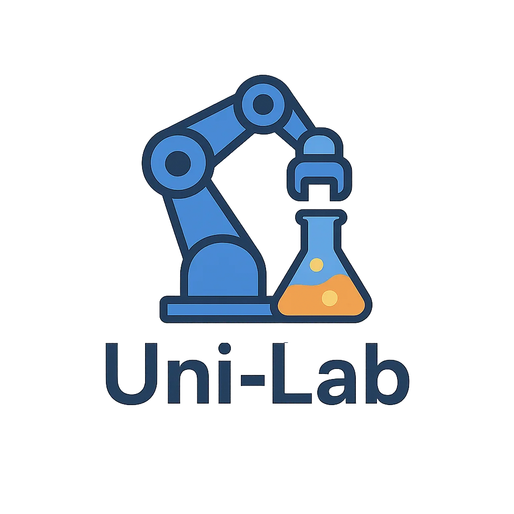

<div align="center">
  
</div>

# Uni-Lab-OS

<!-- Language switcher -->

**English** | [中文](README_zh.md)

[](https://github.com/deepmodeling/Uni-Lab-OS/stargazers)
[](https://github.com/deepmodeling/Uni-Lab-OS/network/members)
[](https://github.com/deepmodeling/Uni-Lab-OS/issues)
[](https://github.com/deepmodeling/Uni-Lab-OS/blob/main/LICENSE)

Uni-Lab-OS connects laboratory equipment and runs experimental workflows. The public edition ships a serial Task scheduler: Tasks enter a queue and advance in FIFO order (first in, first out). Within the current Task, jobs may run together when their dependencies and resources allow. Pausing holds the head of the queue. A failed or canceled Task must finish settlement before the next Task starts. Device calls, inventory, durable start permission, human authorization, and result recovery remain platform responsibilities.

The Python package and the native serial library are both version **1.0.0**. Build steps, configuration, and the recorded acceptance run are in the [serial Task note](docs/scheduler/release.md).

## What's included

| Included | Not included |
| --- | --- |
| Open-source FIFO scheduler `unilab.queue` and the Rust library built from `native/scheduler-queue` | CP-SAT (constraint programming SAT) sources, commercial dynamic libraries, and commercial build dependencies |
| Shared scheduler protocol, plugin host, and independent worker | Private parent history from other repositories |
| Host, workflow, material, and edge code that drives the scheduler | In-tree device drivers. Drivers ship as separate packages under their own licenses |
| Public acceptance suite [`tests/scheduling`](tests/scheduling) | The old time-planning algorithm. Those settings do not select an engine |

The default is `UNILABOS_SCHEDULING_ENGINE=queue`. At startup the host loads the native library from `unilabos/scheduling/queue_native/plugin.json`. The runtime does not invoke a compiler and does not fall back to a Python scheduler. Setting the engine to `plugin` loads a different engine from the path in `UNILABOS_SCHEDULING_MANIFEST`.

Queue policy is fixed:

| Key | Value |
| --- | --- |
| `queue_order` | `fifo` |
| `paused_task` | `hold` |
| `failed_task` | `advance_after_settlement` |
| `canceled_task` | `advance_after_settlement` |
| `manual_outside_scope` | `reject` |

Public CI (continuous integration) is [`.github/workflows/public-scheduler.yml`](.github/workflows/public-scheduler.yml). It builds the real library and runs `tests/scheduling` on Linux, macOS, and Windows with Python 3.11.

## Requirements

- Python 3.11 or newer
- A stable Rust toolchain, to compile the serial library from this tree

## Install

From the repository root:

```bash
python -m pip install -e . pytest wheel packaging
python native/scheduler-queue/build.py --destination unilabos/scheduling/queue_native
```

The editable install provides the console scripts `unilab`, `unilab-supervisor`, and `unilab-mcp`. Build the serial library with the second command before starting the queue engine. A wheel build compiles that library for the current operating system and CPU and packs it into the wheel:

```bash
python -m pip wheel . --no-deps -w dist/public
```

The wheel tag is `py3-none-<platform>`. The library does not link against CPython. To use a library built in another directory, set `UNILABOS_SCHEDULING_MANIFEST` to that directory's `plugin.json`. The build destination must not already exist.

Protocol manifest and ABI (application binary interface): [`unilabos/scheduling/contract/`](unilabos/scheduling/contract/). Library details: [`native/scheduler-queue/README.md`](native/scheduler-queue/README.md).

## Check the build

```bash
cargo test --locked --manifest-path native/scheduler_shared/Cargo.toml
cargo test --locked --manifest-path native/scheduler-queue/Cargo.toml
UNILAB_TEST_CLEAN_INSTALL=1 python -m pytest -q tests/scheduling
```

`tests/scheduling` exercises the real native library: protocol boundaries, FIFO ordering, pause, advance-after-settlement, idempotence, durable session restore, and a Task run from an installed wheel. The acceptance record is in the [release note](docs/scheduler/release.md).

## Documentation

[docs/index.md](docs/index.md) indexes the documentation set. This page does not list those documents. The serial Task note, [docs/scheduler/release.md](docs/scheduler/release.md), is not in that index.

## Repository map

| Path | What it is |
| --- | --- |
| [`native/scheduler-queue/`](native/scheduler-queue/) | FIFO dynamic library |
| [`native/scheduler_shared/`](native/scheduler_shared/) | Shared Rust protocol and semantic checks |
| [`unilabos/scheduling/`](unilabos/scheduling/) | Python host, queue adapter, and plugin worker |
| [`tests/scheduling/`](tests/scheduling/) | Public scheduler acceptance suite |

## Citation

If you use [Uni-Lab-OS](https://arxiv.org/abs/2512.21766) in academic research, please cite:

```bibtex
@article{gao2025unilabos,
    title = {UniLabOS: An AI-Native Operating System for Autonomous Laboratories},
    doi = {10.48550/arXiv.2512.21766},
    publisher = {arXiv},
    author = {Gao, Jing and Chang, Junhan and Que, Haohui and Xiong, Yanfei and
              Zhang, Shixiang and Qi, Xianwei and Liu, Zhen and Wang, Jun-Jie and
              Ding, Qianjun and Li, Xinyu and Pan, Ziwei and Xie, Qiming and
              Yan, Zhuang and Yan, Junchi and Zhang, Linfeng},
    year = {2025}
}
```

## License

Code in this repository is GPL-3.0. See [LICENSE](LICENSE) and [NOTICE](NOTICE).

`setup.py` does not distribute `unilabos.devices`. Driver packages keep their own license. When that tree is present, `unilabos/devices/` is under the DP Technology proprietary license.

## Contact

- GitHub Issues: <https://github.com/deepmodeling/Uni-Lab-OS/issues>
